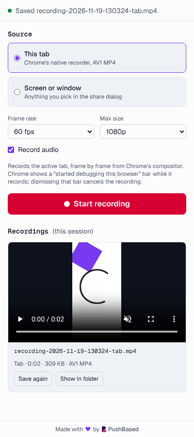

<h1>
  <picture>
    <source media="(prefers-color-scheme: dark)" srcset="design/logo/logo-dark.svg">
    
  </picture>
</h1>

[](https://github.com/push-based/chrome-recorder/actions/workflows/ci.yml)

A Chrome extension that records your screen from a side panel, in two ways:

- **This tab**: Chrome's new native tab recorder, `Page.startScreenRecording`
  (Chrome 153+). Frames come straight from the tab's compositor and Chrome
  encodes AV1 video and Opus audio into an MP4 out of process, so there are no
  dropped frames: 60 fps easily, up to 120 fps on a 120 Hz display.
- **Screen or window**: anything you pick in Chrome's share dialog (a whole
  screen, another app's window or a tab), recorded with `getDisplayMedia` and
  `MediaRecorder` as H.264 MP4, or WebM where MP4 isn't available.

Recordings are saved to `Downloads/chrome-recorder/` and listed in the panel
with a preview.

<p align="center">
  
</p>

The native recording uses the same CDP calls as Paul Irish's
[chrome-capture](https://github.com/paulirish/chrome-capture), which runs them
from Puppeteer or Playwright; this extension runs them through
`chrome.debugger`, so you can record from your everyday browser.

## Use it

1. Build it (below) and load `.output/chrome-mv3` in `chrome://extensions`
   with **Developer mode** on and **Load unpacked**.
2. Click the toolbar icon to open the side panel.
3. Pick a source, frame rate, maximum size and whether to record audio, then
   **Start recording**.
4. **Stop recording**. The file lands in `Downloads/chrome-recorder/`.

### Good to know

- **This tab** shows Chrome's "started debugging this browser" bar while it
  records. That's how Chrome signals `chrome.debugger` use; dismissing the bar
  cancels the recording. Chrome doesn't allow recording its own pages
  (`chrome://…`, the Web Store).
- The tab recorder captures the tab's own pixels: the side panel and the rest
  of Chrome's UI never show up in the video. It stays on the tab it started
  on, even if you switch tabs.
- 120 fps needs a 120 Hz display (for example a ProMotion MacBook).
- Before Chrome 153 the panel offers only **Screen or window**.
- **Screen or window** recording runs in the side panel, so keep it open until
  you stop. Chrome's own "Stop sharing" button stops and saves too.

## Develop

Needs Node 22.18+ and pnpm.

```sh
pnpm install
pnpm dev          # Chrome with the extension loaded and hot reload
pnpm build        # .output/chrome-mv3
pnpm zip          # zip for the Chrome Web Store
pnpm compile      # type check
pnpm lint         # oxlint, including the anti-slop rules
pnpm format       # oxfmt
pnpm test         # unit tests (Vitest)
pnpm e2e          # builds, then records real clips in Chromium (Playwright)
```

The end-to-end tests load the built extension into full Chromium, record a test
page with both sources and check the result. Set `CHROMIUM_PATH` to use a
Chromium that Playwright didn't download.

## How it works

| Part                                        | File                                           |
| ------------------------------------------- | ---------------------------------------------- |
| Side panel UI and download handling         | `src/entrypoints/sidepanel/main.ts`            |
| Native tab recording over `chrome.debugger` | `src/entrypoints/sidepanel/tab-recorder.ts`    |
| Screen recording with `getDisplayMedia`     | `src/entrypoints/sidepanel/screen-recorder.ts` |
| Formatting, codec choice, file names        | `src/shared/format.ts`                         |

The tab recorder attaches `chrome.debugger` to the active tab and sends
`Page.startScreenRecording` with `frameRate`, `maxWidth`, `maxHeight` and
`audio`. On stop it sends `Page.stopScreenRecording`, which returns an
`IO.StreamHandle`, and reads the MP4 out with `IO.read` until `eof`.

## Privacy

Recordings never leave your computer. See [PRIVACY.md](PRIVACY.md).

## License

[Apache 2.0](LICENSE). See [NOTICE](NOTICE).
